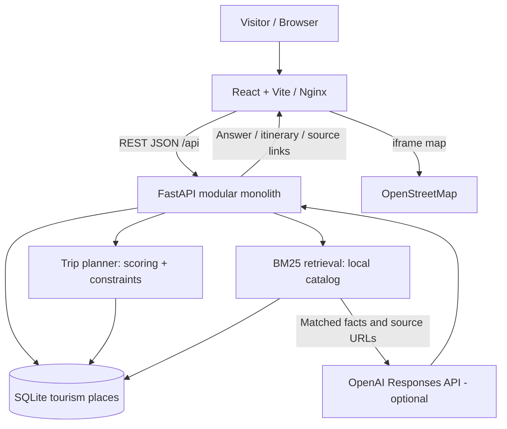

# Masr Guide AI — System Design (MVP v1)

## Architecture overview

### Why modular monolith?

The small scope benefits from a single deployable backend, less coordination overhead, clear modules and testable interfaces. Service splitting would add unnecessary complexity for an initial portfolio MVP.

### LLM guide request sequence

1. User submits text, response language and up to eight short previous turns.
2. FastAPI validates sizes and roles.
3. `guide.retrieve()` normalises the question (Arabic hamza/ya/ta-marbuta, diacritics, definite article; Latin accents), maps Arabic/French words to English catalogue words at token level, and ranks places with **BM25** over field-weighted text (names and cities count more). An exact place name in the question adds a large boost; a **coverage guard** rejects matches that explain too little of the question, so out-of-scope questions return no sources. The index is cached per database file state.
4. Without `OPENAI_API_KEY` the API returns an explicitly labelled **offline preview** (Arabic summaries for Arabic, English text otherwise). It is not claimed to be AI.
5. With a key, the server sends the retrieved facts (description, details, tip) and source URLs to the OpenAI Responses API with instructions to avoid unsupported claims and invented practical details.
6. The UI shows the answer plus numbered source links. Provider failures become a generic 502; there is no silent fallback.

**Trust boundary:** references, user questions and history are untrusted text; the prompt tells the model not to follow instructions inside them. This reduces, but does not eliminate, prompt-injection risk.

### Trip planning algorithm

- Validate cities and 1–14 days; optionally re-order cities (first stays the start) by brute-force over permutations to minimise estimated transfer time.
- One day per city minimum; extra days go to cities with the most remaining catalogue capacity; each city's days stay contiguous.
- **Inter-city transfer estimate**: straight-line distance between city centres × 1.3 at 65 km/h (min 45 min). A 4 h door-to-door flight is assumed only between major-airport cities when the road trip would exceed 6 h. The estimate is deducted from the first day in the new city; very long days yield a "travel day" note and a warning.
- Within a day, unique places are chosen by tag overlap and family fit with a soft distance penalty, under 240/360/450-minute activity budgets plus a generic 30-minute between-stop allowance.
- Days the catalogue cannot fill are left empty with a note and a plan-level warning. Server-written text follows `language` (`en`/`ar`).
- No live fares, opening hours or schedules; the API retains an unused optional budget field for compatibility, but the frontend does not ask for it.

### Persistence

- SQLite catalog auto-seeded on app startup with stable IDs.
- Browser localStorage stores the user's most recently saved itinerary only when the user explicitly selects **Save**.
- Chat is ephemeral in browser memory; no conversation database. Recent chat messages are still submitted to FastAPI and forwarded to the external model provider when OpenAI is enabled. Avoid sharing sensitive personal data.

### Frontend routes

A React view switcher provides Home, Explore, Trip planner and AI guide without a router dependency. Interactive OpenStreetMap embed changes on destination selection. Browser uses relative `/api` calls through a Vite development proxy or an Nginx Docker proxy.

### Nonfunctional constraints and production improvements

- Replace the demo-only in-process per-peer rate limiter with trusted edge / distributed rate limits, daily token ceilings, authenticated access or CAPTCHA, structured logs, source review, prompt-injection tests and automatic catalog refresh for public operation.
- Public deployment should use TLS, environment secrets, health probes, readiness gates and uptime monitoring.
- Add internationalization/localized verified descriptions if all-language experience is required when OpenAI is unavailable.
- Consider pgvector + embeddings only after measuring retrieval failure cases on a bilingual evaluation set.

### Frontend

Navigation uses hash routing implemented in `App.jsx` (no dependency): `pushState` on navigation, `popstate`/`hashchange` listeners, unknown hashes fall back to Home. Opening a place from another page remounts Discover (via a `key`) so stale filters cannot hide it, avoiding an effect-based state reset. Components live in `frontend/src/components`; `i18n.jsx` provides a context with `t()`, localised place/city helpers and sets `<html lang dir>`; all strings are in `messages.js` and a test enforces EN/AR key and placeholder parity. Arabic mode applies RTL overrides and disables letter-spacing (which breaks Arabic joining).

### Concurrency and data

`database.initialize()` rebuilds the derived `places` table in **one explicit `BEGIN IMMEDIATE` transaction** (Python's sqlite3 does not open a transaction before DDL, so without this a concurrent reader could observe a missing table; a regression test reproduces that failure mode). The retrieval index is built under a lock and cached per database-file state.

### Operations

- Backend container: non-root user, `/api/health` healthcheck; `docker-compose` waits for it before starting Nginx.
- Nginx: CSP without `unsafe-inline` (self + Google Fonts CSS + OpenStreetMap frames), `nosniff`, `X-Frame-Options`, per-IP throttle on `/api/chat` (12/min, burst 6). The backend limiter keys on `X-Real-IP` only when `TRUST_PROXY_HEADERS=1`; otherwise client-supplied headers are ignored because they can be spoofed. This is a **demo configuration**; public use needs TLS, real client identity at the edge, budget caps, logging and distributed quotas.
- `GET /api/health` reports `llm-configured` when a key exists and `llm-rag` only after a successful chat.
